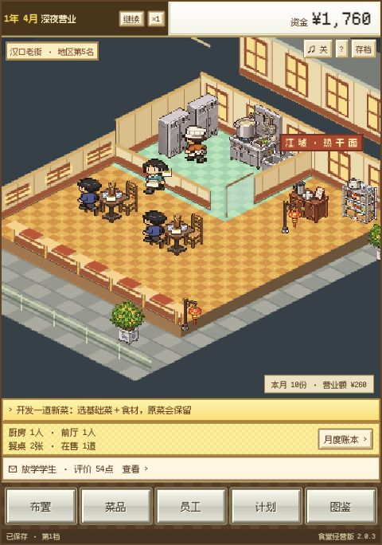
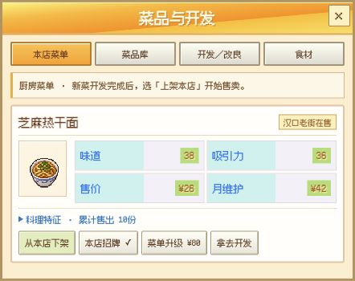
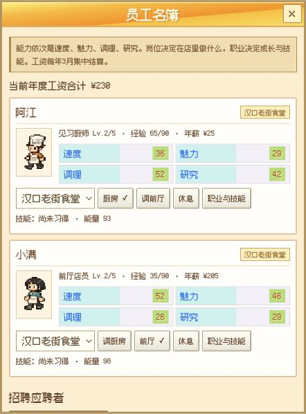

# 江城食堂 · 武汉夜市

**从一碗芝麻热干面开始，在汉口老街开一家自己的像素食堂。**

《江城食堂》是一款可以在浏览器里玩的单人餐厅经营游戏。安排厨房和前厅，给新菜找搭配，看客人坐下、点餐、吃饭和打分，再用一晚晚攒下的钱把小店做大。

<p align="center">
  
</p>

## 从第一桌到下一家店

| 你来做什么 | 店里会发生什么 |
| --- | --- |
| 布置店面 | 添木桌和雅座，摆上桂花盆景或茶台，给客人和送餐员工留出通道。 |
| 开发武汉小吃 | 用基础菜配上酸豆角、桂花等食材，开发新菜或改良原有菜谱。上架后可以从顾客评价看出搭配是否合适。 |
| 培养店员 | 厨房和前厅分别积累经验。安排员工转职、装备技能，也可以派人去探索食材。 |
| 听街坊提议 | 争取不同客群的好评，解锁经营提案、食材和设施，再把生意开到新的地区。 |
| 看账本、开分店 | 每月结算后安排下一步。经营到第 16 年 3 月会记录成绩，之后可以继续开店，也能带着招牌菜进入新周目。 |

当前版本有 **24 道菜、16 种食材、11 个客群、12 名员工、8 个职业和 4 个地区**。

## 菜单与员工

| 菜品与开发 | 员工名簿 |
| :---: | :---: |
|  |  |
| 选招牌、调整在售菜品，或把现有菜品拿去开发。 | 看员工的速度、魅力、调理和研究能力，再安排岗位。 |

## 本地开张

需要一个现代浏览器和 Python 3。游戏由静态网页运行，素材与约三分钟的配乐《江城晚风》都在仓库里。

```bash
git clone https://github.com/davidai1024/jiangcheng-cafeteria.git
cd jiangcheng-cafeteria
python3 -m http.server 8000 --bind 127.0.0.1
```

打开 [http://127.0.0.1:8000](http://127.0.0.1:8000)，选「新开食堂」、一个空档和一款起步菜。初次营业可以先看一桌客人走完点餐和送餐，再到「菜品」试试用芝麻热干面搭配酸豆角。

三个档位保存在当前浏览器。换设备或浏览器时，从「存档」导出备份，再在新环境导入。打开面板或提示时游戏会暂停，月末可以先整理经营安排，再点「进入下月」。

## 项目文件

| 文件 | 内容 |
| --- | --- |
| `index.html`、`style.css` | 开场、营业界面和经营面板 |
| `app.js` | 界面交互、引导、本地存档和音频 |
| `engine.js`、`data.js` | 经营模拟、菜谱、员工、设施与地区数据 |
| `world.js` | Canvas 像素场景、人物和家具绘制 |
| `assets/` | 游戏图片、音乐、字体及随附授权文件 |

## 参考与素材

经营结构和画面布局参考开罗《美食梦物语》。武汉题材、美术与配乐由本项目制作，菜品和经营参数在本项目中独立配置。页面中的三张图片均为 **2.0.3 实际运行截图**。 [开罗官方游戏介绍](https://kairosoft.net/game/appli/restaurant.html)

像素字使用 Fusion Pixel Font，字体授权与上游声明随文件一并收录。 [字体授权文件](assets/字体授权/Fusion-Pixel-LICENSE-OFL.txt) · [Fusion Pixel Font 项目](https://github.com/TakWolf/fusion-pixel-font)
